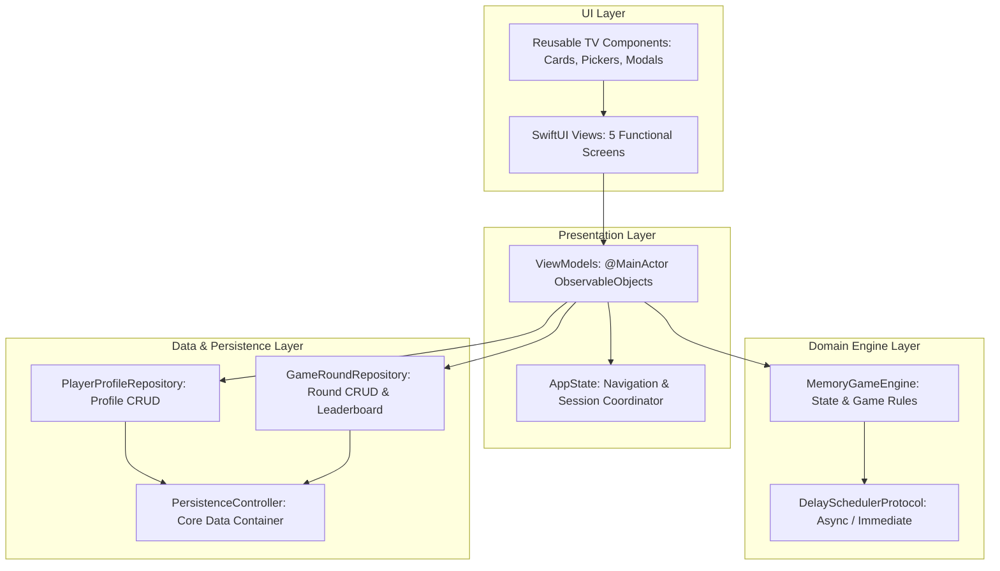
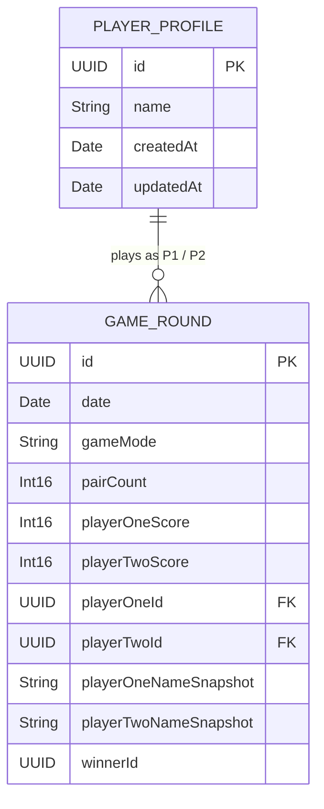

# Architecture & Design Document: MemoryMatch (tvOS)

**Student:** Abhilash K A T W (IT22081698)  
**Module:** SE4041 – Mobile Application Design and Development  
**Assignment:** Assignment 02, Part B (tvOS)  
**Platform Target:** Apple tvOS 17.0+  

---

## 1. Architectural Overview

MemoryMatch follows a strict **Model-View-ViewModel (MVVM)** architecture augmented by an isolated Domain Game Engine and a Core Data Repository abstraction layer.

---

## 2. Key Architectural Tenets

### 2.1 MVVM Presentation Layer
- **`AppState`:** Holds high-level application routing state (`AppRoute`), chosen configuration (Mode and Difficulty), currently active player profiles, and repository references.
- **Dedicated ViewModels:** Each of the five screens possesses an independent `@MainActor` ViewModel (`HomeViewModel`, `PlayerSetupViewModel`, `GameBoardViewModel`, `ResultsViewModel`, `LeaderboardViewModel`).
- **Separation of Concerns:** Views only render declarative SwiftUI hierarchies; all state mutations, business rules, and validation reside in ViewModels and Domain Engines.

### 2.2 Foundation-Only Domain Game Engine
- **`MemoryGameEngine`:** Manages the active board state, card array, active player, scores, match verification, and turn retention.
- **Inversion of Control for Time:** Instead of tying timer logic to SwiftUI views or blocking threads with `sleep()`, the engine accepts a `DelaySchedulerProtocol`. In production, `AsyncDelayScheduler` manages asynchronous `DispatchWorkItem` execution. In unit tests, `ImmediateDelayScheduler` enables deterministic, instantaneous execution.
- **Stale Callback Prevention:** Every round is tagged with a unique `roundId: UUID`. Pending asynchronous mismatch callbacks capture the originating `roundId`. If the player restarts or exits the round before the callback fires, the callback compares IDs and safely self-terminates without mutating the new board.

### 2.3 Core Data Persistence & Snapshot Preservation
The database schema decouples historical accuracy from mutable player profiles:

#### Snapshot Invariance Guarantee:
1. `GameRoundEntity` stores string snapshots: `playerOneNameSnapshot` and `playerTwoNameSnapshot`.
2. Core Data relationship delete rules are set to `Nullify`.
3. If a user deletes a player profile via "Manage Players", the relationship pointers on historical rounds become `nil`, but the historical scores, dates, and player names remain intact on the Leaderboard.

---

## 3. tvOS Storage Lifecycle Considerations

According to official Apple tvOS Human Interface Guidelines and Developer Documentation:
- **No Local Document Storage:** Apple TV does not provide guaranteed permanent local storage in `.documentDirectory`.
- **Sandbox Directories:** tvOS apps write to `.applicationSupportDirectory` or `.cachesDirectory`.
- **System Purging:** Under storage pressure, tvOS may purge cached files when the app is inactive.
- **MemoryMatch Resilience:** `PersistenceController` creates its SQLite store inside `Application Support`. If the store file is missing, corrupt, or wiped by the OS, `PersistenceController` gracefully falls back to an in-memory store and re-seeds default profiles (`Maya` and `Leo`) to avoid application crashes.

---

## 4. Single-Remote Focus Navigation Model

In Apple tvOS, interaction is governed by the system Focus Engine:
1. **Focus Restoration:** Custom view hierarchies utilize `.focused()` and `@FocusState` to preserve remote position across state updates.
2. **Focus vs. Selection Separation:** Selection state (e.g. chosen game mode or difficulty) is visually represented by solid outlines and persistent checkmark badges. Remote focus is represented by the native expansion scale (1.05x–1.08x) and mint-teal luminous glow.
3. **Accessibility Shielding:** Face-down cards report non-revealing accessibility labels (`"Hidden card, row X, column Y"`). The hidden item name and SF Symbol are never emitted to VoiceOver or accessibility trees until the card is flipped or matched.
